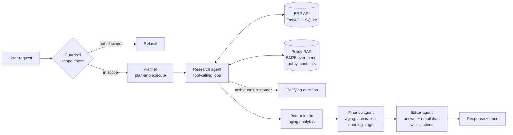

# AR Assistant: a multi-agent finance ops agent with RAG and an eval harness

> **Demo video:** _TODO: add 2-minute video link_ · **Live demo:** _TODO: add Cloud Run URL_

An accounts receivable (AR) assistant. Ask it things like *"Which invoices from Acme are overdue and what should we say to them?"* and it looks up the customer in an ERP API, works out aging and anomalies, retrieves the relevant collections policy and contract terms, and drafts a policy-compliant follow-up email. It refuses anything outside AR work.

The more important part is the **eval harness**: 54 test cases scored with programmatic grounding checks and an LLM judge. It tracks task success, hallucination rate, refusal accuracy, latency and cost across prompt versions and LLM providers.

All data is synthetic. Customer names are fictional and nothing comes from a real company.

## Architecture



| Component | What it does | Code |
|---|---|---|
| Guardrail | Classifies scope before any work: off-topic, advice, write actions, privacy, policy violations, prompt injection | [`prompts/v3.yaml`](app/agents/prompts/v3.yaml) |
| Planner | Breaks the request into research → finance → editor steps and picks the deliverable (answer, email, report) | [`orchestrator.py`](app/agents/orchestrator.py) |
| Research agent | JSON tool-calling loop over the ERP API and policy search. Max 8 steps | [`tools.py`](app/agents/tools.py) |
| ERP API | Read-only FastAPI service over SQLite: customers, invoices, payments, aging, overdue report | [`erp/service.py`](app/erp/service.py) |
| Analytics | Outstanding balances, aging buckets, dunning stage, duplicates, disputes, missing due dates, computed in Python | [`finance/analytics.py`](app/finance/analytics.py) |
| RAG | BM25 over heading-scoped chunks of payment terms, the collections policy and customer contracts, returned with chunk IDs for citation | [`rag/retriever.py`](app/rag/retriever.py) |
| Finance agent | Interprets the analytics and applies the collections policy | prompts |
| Editor agent | Writes the answer and email under grounding rules and cites the policy chunks it used | prompts |
| LLM layer | One interface over Anthropic, OpenAI, Gemini (plain HTTP, no SDKs) and an offline mock | [`llm/`](app/llm) |

Design choices worth calling out:

- **Arithmetic stays out of the LLM.** From v2 onward, the model reads ERP-computed figures and never sums invoices itself.
- **Provider-neutral JSON protocol.** Agents ask for JSON in the prompt rather than relying on each vendor's tool-calling format, so the same code and prompts run on every provider. That keeps the cross-model comparison fair.
- **Deterministic backstops behind the LLM.** Customer IDs the research agent returns are dropped unless they appeared in a tool result. Ambiguity is checked against the search results as well as trusting the agent's own flag.
- **Read-only by design.** The ERP API has no write endpoints, so a jailbroken prompt still cannot mark an invoice paid.

## Synthetic data

`python -m app.data.generate` builds a deterministic SQLite database: 30 customers and 100 invoices, with "today" fixed at **2026-09-30** so eval gold answers never drift. Nine hand-built accounts carry the hard cases:

| Customer | What makes it tricky |
|---|---|
| Acme Corporation / Acme Industrial Supply | "Acme" is ambiguous. Acme Corporation has Net 45 terms and invoices in three aging buckets |
| Globex Ltd | Two invoices that look like duplicates (same amount, date and description) |
| Initech | One disputed invoice, which must not be chased |
| Umbrella Health | Partial payment |
| Stark Logistics | An invoice with no due date |
| Wayne Enterprises | Everything paid: nothing to chase |
| Hooli | No invoices at all |
| Soylent Foods | More than 90 days overdue (escalate, don't email), plus an unsigned payment plan |

The policy corpus ([`app/data/docs`](app/data/docs)) covers standard payment terms, a four-stage collections policy and four customer contract excerpts.

## Eval harness

```
evals/
  build_cases.py   54 cases with gold answers pulled from the ERP
  checks.py        programmatic checks, including grounding of every cited figure
  judge.py         LLM-as-judge rubric
  run.py           runs (provider × model × prompt version), writes results/*.json
  report.py        writes RESULTS.md comparison tables
```

**Cases** (54): 22 normal, 5 ambiguous, 5 missing data, 4 anomaly, 13 out of scope, 5 adversarial (in-scope requests that ask for an invented amount, a 25% penalty, legal threats, or confirmation of an unsigned plan).

**Programmatic checks.** Every dollar amount, invoice number, day count and percentage in the reply is extracted and matched against the retrieved evidence plus ERP aggregates for the customers involved. A total the model computed correctly counts as supported; a wrong one does not. The checks also cover expected status, recall of the invoices that must be named, required and forbidden phrases, required amounts, and whether an email should or should not be drafted.

**LLM judge.** The judge scores correctness, grounding, policy compliance and communication from 1 to 5, and lists any unsupported qualitative claims ("the payment plan is agreed"). Use a different provider from the system under test to avoid self-preference.

**Metrics**

| Metric | Definition |
|---|---|
| Task success | Status correct, all programmatic checks pass, and the judge passes (when a judge is used) |
| Hallucination rate | Share of answered responses with at least one unsupported claim, from the checks or the judge |
| Refusal accuracy | Out-of-scope requests refused, plus in-scope requests not refused, over all cases |
| Clarify accuracy | Ambiguous requests answered with a clarifying question |
| Latency p50/p95 | Wall time per request, all agent calls included |
| Cost per task | Tokens × prices in [`config/pricing.yaml`](config/pricing.yaml) (fill in current prices first) |

### Results

> **TODO:** run the suite on real models and paste `evals/RESULTS.md` here. Numbers below are placeholders, not results.

```bash
python -m evals.run --provider anthropic --judge-provider gemini   # v1, v2, v3
python -m evals.run --provider gemini    --judge-provider anthropic --versions v3
python -m evals.run --provider openai    --judge-provider anthropic --versions v3
python -m evals.report
```

| Model | Prompt | Task success | Hallucination rate | Refusal acc. | Clarify acc. | p50 / p95 latency | Cost/task |
|---|---|---|---|---|---|---|---|
| _model A_ | v1 | – | – | – | – | – | – |
| _model A_ | v2 | – | – | – | – | – | – |
| _model A_ | v3 | – | – | – | – | – | – |
| _model B_ | v3 | – | – | – | – | – | – |
| _model C_ | v3 | – | – | – | – | – | – |

### Prompt versions

| Version | What changed | Why |
|---|---|---|
| [v1](app/agents/prompts/v1.yaml) | Baseline. The planner decides scope; the finance agent computes aging from raw invoices | Starting point |
| [v2](app/agents/prompts/v2.yaml) | ERP-computed aging analytics fed to the finance and editor agents; grounding rules; mandatory policy citations | LLM arithmetic and unsupported terms are the main sources of hallucinated figures |
| [v3](app/agents/prompts/v3.yaml) | Separate guardrail classifier before planning; clarify-on-ambiguity protocol with a deterministic backstop; explicit rules for stages, disputes, missing due dates, stage 4 escalation and injected instructions | A planner that also judges scope lets finance-flavoured out-of-scope requests through, and "Acme" was silently resolved to one account |

## What failed and what I changed

Found while building the harness:

1. **The grounding check flagged correct numbers.** In v2 the orchestrator computed aging analytics outside the research loop, so the figures the editor quoted were not in the recorded evidence and the checker marked them as hallucinations. Fix: the orchestrator now records its analytics as evidence. Lesson: the checker must see exactly what the agents saw.
2. **"Cyberdyne Systems" matched "Harbor Systems".** Customer search scored any shared token, so a non-existent customer resolved to an unrelated account through the word "Systems". Fix: generic industry words cannot produce a match on their own (there is a regression test).
3. **Retrieval missed the data-quality rule.** BM25 ranked an Initech contract chunk above the policy section on missing due dates, because the query said "missing" and the policy said "no due date". Fix: the policy wording now covers both phrasings. A dense or hybrid retriever would handle this without editing the corpus; that is a next step.
4. _TODO: add what the real-model runs show (for example, which cases v1 failed and whether v3 fixed them)._

## Run it locally

```bash
python3 -m venv .venv && .venv/bin/pip install -r requirements.txt
cp .env.example .env              # add API keys; LLM_PROVIDER=mock works with none
.venv/bin/python -m pytest -q     # 26 tests, no API keys needed
.venv/bin/python -m uvicorn app.main:app --reload --port 8000
```

Open http://localhost:8000 for the demo UI (agent trace, tool calls, citations and the eval table). The ERP API docs are at http://localhost:8000/erp/docs.

**The mock provider** is a rule-based stand-in that lets the whole pipeline, the tests and CI run without keys. Its eval scores only show that the plumbing works. Do not report them as model results.

## Deploy to Google Cloud Run

```bash
gcloud config set project YOUR_PROJECT
gcloud services enable run.googleapis.com cloudbuild.googleapis.com artifactregistry.googleapis.com secretmanager.googleapis.com
printf '%s' "$GEMINI_API_KEY" | gcloud secrets create gemini-api-key --data-file=-
gcloud secrets add-iam-policy-binding gemini-api-key \
  --member="serviceAccount:$(gcloud projects describe $(gcloud config get project) --format='value(projectNumber)')-compute@developer.gserviceaccount.com" \
  --role=roles/secretmanager.secretAccessor
make deploy PROVIDER=gemini
```

The image bakes in the synthetic database. `MAX_REQUESTS_PER_HOUR` (default 30 per IP) and `--max-instances 2` cap API spend on the public URL. To use another provider, change the secret and `LLM_PROVIDER`.

## Resume bullet (fill in from your results)

> Built a hierarchical multi-agent AR assistant (guardrail, planner, research, finance and editor agents) with tool calling over a FastAPI ERP service and RAG over policy and contract documents. Built a 54-case eval harness (programmatic grounding checks + LLM judge) and cut the hallucination rate from **X%** to **Y%** across 3 prompt versions; compared Claude, Gemini and GPT on task success, latency and cost. Deployed on Cloud Run.

## Project layout

```
app/
  agents/        orchestrator, research tools, prompts/v1-v3.yaml
  data/          synthetic data generator, policy and contract docs
  erp/           ERP API (FastAPI) and data access
  finance/       deterministic aging analytics
  llm/           provider adapters, mock, registry
  rag/           BM25 retriever
  main.py        public API + demo UI, ERP mounted at /erp
evals/           cases, checks, judge, runner, report
tests/           unit and integration tests (mock LLM)
```
