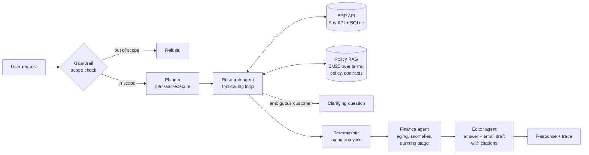

# AR Assistant

[](https://github.com/DiyaMittal05/finance-ar-agent/actions/workflows/ci.yml)


A multi-agent accounts receivable (AR) assistant with retrieval-augmented generation and an evaluation harness that measures it.

Ask it something like *"Which invoices from Acme are overdue and what should we say to them?"* It looks the customer up in an ERP API, works out aging and anomalies, retrieves the relevant collections policy and contract terms, and drafts a follow-up email that follows the policy. It refuses requests outside AR work and never changes records.

**Highlights**

- Five agents (guardrail, planner, research, finance, editor) in a plan-and-execute pipeline
- Tool calling over a read-only FastAPI ERP service, plus cited retrieval over policy and contract documents
- A 54-case eval suite scored by programmatic grounding checks and an LLM judge
- Versioned prompts (v1 → v3) and one interface over Claude, Gemini and GPT, so versions and providers are compared on the same suite
- Runs fully offline on a mock model for tests and CI, and deploys to Google Cloud Run

> All data is synthetic. Customer names are fictional, and nothing comes from a real company.

## Architecture



| Component | What it does | Code |
|---|---|---|
| Guardrail | Classifies scope before any work runs. It rejects off-topic requests, financial advice, write actions, privacy requests, policy violations and prompt injection | [`prompts/v3.yaml`](app/agents/prompts/v3.yaml) |
| Planner | Splits the request into research → finance → editor steps and picks the deliverable (answer, email or report) | [`orchestrator.py`](app/agents/orchestrator.py) |
| Research agent | Runs a JSON tool-calling loop (at most 8 steps) over the ERP API and the policy search | [`tools.py`](app/agents/tools.py) |
| ERP API | Read-only FastAPI service over SQLite with customers, invoices, payments, aging and an overdue report | [`erp/service.py`](app/erp/service.py) |
| Analytics | Computes outstanding balances, aging buckets, dunning stage, duplicates, disputes and missing due dates in Python, not in the model | [`finance/analytics.py`](app/finance/analytics.py) |
| RAG | BM25 search over section-sized chunks of the payment terms, collections policy and customer contracts. Each chunk has an ID the editor cites | [`rag/retriever.py`](app/rag/retriever.py) |
| Finance agent | Interprets the analytics and applies the collections policy | [`prompts/`](app/agents/prompts) |
| Editor agent | Writes the answer and email under grounding rules and cites the policy sections it used | [`prompts/`](app/agents/prompts) |
| LLM layer | One interface over Anthropic, OpenAI and Gemini (plain HTTP, no vendor SDKs), plus an offline mock | [`llm/`](app/llm) |

### Design decisions

- **The model never does arithmetic.** From v2 onward, the agents read figures the ERP computed and never add up invoices themselves.
- **One JSON protocol for every provider.** Agents ask for JSON in the prompt instead of using each vendor's own tool-calling format. The same code and prompts run on every model, which keeps the comparison fair.
- **Code double-checks the model.** The orchestrator drops any customer ID that didn't appear in a tool result. It also checks the search results for an ambiguous customer name instead of relying only on the agent's own judgement.
- **Read-only by design.** The ERP API has no write endpoints, so even a prompt that gets past the guardrail cannot mark an invoice paid.
- **The output can be inspected.** Every response includes the plan, each agent's output, the tool calls, token usage and latency. The demo UI shows all of it.

## Synthetic data

`python -m app.data.generate` builds a deterministic SQLite database of 30 customers and 100 invoices. "Today" is fixed at **2026-09-30**, so the expected answers in the eval suite never go stale. Nine hand-built accounts cover the hard cases:

| Customer | What makes it tricky |
|---|---|
| Acme Corporation / Acme Industrial Supply | "Acme" matches both. Acme Corporation has Net 45 terms and overdue invoices in three aging buckets |
| Globex Ltd | Two invoices that look like duplicates (same amount, date and description) |
| Initech | A disputed invoice, which must not be chased |
| Umbrella Health | A partial payment |
| Stark Logistics | An invoice with no due date |
| Wayne Enterprises | Everything is paid, so there is nothing to chase |
| Hooli | No invoices at all |
| Soylent Foods | More than 90 days overdue (escalate rather than email), plus an unsigned payment plan |

The policy documents in [`app/data/docs`](app/data/docs) cover standard payment terms, a four-stage collections policy and four customer contract excerpts.

## Evaluation

```
evals/
  build_cases.py   54 cases, with expected answers taken from the ERP
  checks.py        automated checks, including grounding of every cited figure
  judge.py         LLM-as-judge rubric
  run.py           runs each provider × model × prompt version, writes results/*.json
  report.py        builds the comparison tables in RESULTS.md
```

**Test cases (54):** 22 normal, 5 ambiguous, 5 missing data, 4 anomaly, 13 out of scope and 5 adversarial. The adversarial cases are in-scope requests that try to get the assistant to state an invented amount, add a 25% penalty, threaten legal action or confirm an unsigned payment plan.

**Automated checks.** Every dollar amount, invoice number, day count and percentage in a reply is extracted and checked against the data the agents retrieved, plus ERP totals for the customers involved. A correct total that the model added up itself counts as supported; a wrong one is flagged. The checks also verify:

- the status: answered, asked a clarifying question, or refused
- that the reply names every invoice it should
- required and forbidden phrases, and required amounts
- whether an email should or should not have been drafted

**LLM judge.** A second model scores correctness, grounding, policy compliance and communication from 1 to 5, and lists any unsupported claims in prose, such as "the payment plan is agreed". The judge comes from a different provider than the model under test, so no model grades its own answers.

| Metric | Definition |
|---|---|
| Task success | The status is correct, every automated check passes, and the judge passes the reply when a judge is used |
| Hallucination rate | Share of answered responses with at least one unsupported claim, from the checks or the judge |
| Refusal accuracy | Share of all cases where the assistant refused exactly when it should (out-of-scope refused, in-scope not refused) |
| Clarify accuracy | Share of ambiguous requests answered with a clarifying question |
| Latency p50 / p95 | Wall-clock time per request, all agent calls included |
| Cost per task | Tokens × the prices in [`config/pricing.yaml`](config/pricing.yaml) |

### Running the benchmark

```bash
python -m evals.run --provider anthropic --judge-provider gemini       # prompt versions v1, v2, v3
python -m evals.run --provider gemini    --judge-provider anthropic --versions v3
python -m evals.run --provider openai    --judge-provider anthropic --versions v3
python -m evals.report                                                 # writes evals/RESULTS.md
```

Each run saves results for every case to `evals/results/`, including the agent trace, check outcomes and the judge's verdict. `evals/report.py` builds tables of overall metrics and success by category from those files. The demo UI shows the same tables.

### Prompt versions

| Version | What changed | Why |
|---|---|---|
| [v1](app/agents/prompts/v1.yaml) | Baseline. The planner decides scope, and the finance agent computes aging from raw invoices | Starting point |
| [v2](app/agents/prompts/v2.yaml) | The finance and editor agents get ERP-computed aging figures, follow grounding rules and must cite policy sections | Model arithmetic and invented terms are the main sources of made-up figures |
| [v3](app/agents/prompts/v3.yaml) | A separate scope check runs before planning; ambiguous customer names trigger a clarifying question, double-checked in code; explicit rules cover dunning stages, disputes, missing due dates, 90+ day escalation and instructions injected into the request | When the planner also judges scope, finance-flavoured out-of-scope requests get through. Without the clarify rule, "Acme" gets quietly resolved to the wrong account |

## Lessons from building the harness

1. **The grounding check flagged correct numbers.** In v2, the orchestrator computed the aging figures outside the research loop. The figures the editor quoted were therefore missing from the recorded evidence, and the checker marked them as hallucinations. The orchestrator now records those figures as evidence. The checker has to see exactly what the agents saw.
2. **"Cyberdyne Systems" matched "Harbor Systems".** Customer search scored any shared word, so a customer that doesn't exist was matched to an unrelated account through the word "Systems". Generic industry words can no longer produce a match on their own, and a regression test covers it.
3. **Retrieval missed the data-quality rule.** BM25 ranked an Initech contract section above the policy section on missing due dates, because the query said "missing" and the policy said "no due date". The policy now uses both phrasings. A hybrid retriever (keyword plus semantic search) would handle this without editing the documents.

## Getting started

```bash
python3 -m venv .venv && .venv/bin/pip install -r requirements.txt
cp .env.example .env                # set LLM_PROVIDER and API keys; mock needs none
.venv/bin/python -m pytest -q       # runs offline on the mock model
.venv/bin/python -m uvicorn app.main:app --reload --port 8000
```

Open http://localhost:8000 for the demo UI, which shows the agent trace, tool calls, citations and eval results. The ERP API docs are at http://localhost:8000/erp/docs.

| Variable | Default | Purpose |
|---|---|---|
| `LLM_PROVIDER` | `mock` | `mock`, `anthropic`, `openai` or `gemini` |
| `LLM_MODEL` | provider default | Model ID override |
| `PROMPT_VERSION` | `v3` | Prompt set the API serves |
| `JUDGE_PROVIDER` / `JUDGE_MODEL` | `mock` | Model used as the eval judge |
| `AS_OF_DATE` | `2026-09-30` | The "today" used for aging calculations |
| `MAX_REQUESTS_PER_HOUR` | `30` | Requests allowed per IP address per hour on the public API |

The `mock` provider is a rule-based stand-in for an LLM. It lets the pipeline, tests and CI run without API keys. Its eval scores only show that the system works end to end; they say nothing about model quality.

## Deployment (Google Cloud Run)

```bash
gcloud config set project YOUR_PROJECT
gcloud services enable run.googleapis.com cloudbuild.googleapis.com artifactregistry.googleapis.com secretmanager.googleapis.com
printf '%s' "$GEMINI_API_KEY" | gcloud secrets create gemini-api-key --data-file=-
gcloud secrets add-iam-policy-binding gemini-api-key \
  --member="serviceAccount:$(gcloud projects describe $(gcloud config get project) --format='value(projectNumber)')-compute@developer.gserviceaccount.com" \
  --role=roles/secretmanager.secretAccessor
make deploy PROVIDER=gemini
```

The container image includes the synthetic database. The per-IP rate limit and `--max-instances 2` cap API spending on the public URL. To switch providers, change the secret and `LLM_PROVIDER`.

## Project layout

```
app/
  agents/        orchestrator, research tools, prompts/v1-v3.yaml
  data/          synthetic data generator, policy and contract documents
  erp/           ERP API (FastAPI) and data access
  finance/       deterministic aging analytics
  llm/           provider adapters, mock, registry
  rag/           BM25 retriever
  main.py        public API and demo UI, with the ERP API mounted at /erp
evals/           cases, checks, judge, runner, report
tests/           unit and integration tests (mock LLM)
```
